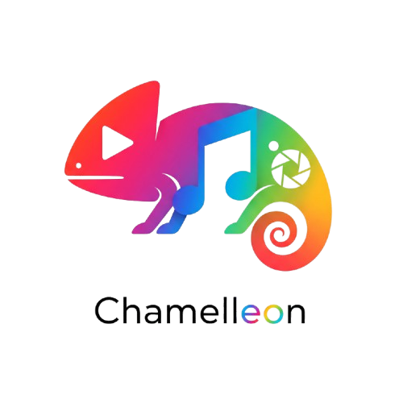

<div align="center">
  
  <h1>Chamelleon</h1>
  <p><strong>Your All-in-One Local Media Shapeshifter 🦎</strong></p>
</div>

Chamelleon is a modern, fast, and privacy-first desktop application built for manipulating media files. It combines the immense power of tools like FFmpeg and Go image processing libraries with a beautiful, seamless, and user-friendly interface. 

Instead of relying on slow cloud converters with file size limits and privacy concerns, Chamelleon processes everything locally on your machine at blistering speeds.

---

## ✨ Features

Chamelleon acts as a "Swiss Army Knife" for media files, split into two main categories: Video and Image.

### 🎬 Video Tools
* **Smart Video Converter:** Convert videos seamlessly to various formats (MP4, WebM, MKV, MOV).
  * *Smart Engine:* Automatically detects compatible codecs to perform lossless, instant stream-copying when possible.
  * *Hardware Acceleration:* Automatically utilizes your GPU (NVENC, QSV, AMF, VideoToolbox) for up to 10x faster encoding when re-encoding is strictly necessary.
* **Intelligent Video Compressor:** Dramatically reduce video file sizes with tailored presets (Lower Bitrate, Reduce Resolution, Change Codec, Adjust Framerate, Best Balance).
* **Video Trimmer & GIF Maker:** Easily extract specific, precise segments from a video using a visual time slider. Option to extract lossless clips or generate high-quality optimized GIFs.

### 🖼️ Image Tools
* **Image Converter:** Drag-and-drop conversion between modern media formats (PNG, JPG/JPEG, WebP, GIF, ICO) without uploading files to the cloud.
* **Image Compressor:** Shrink image file sizes visually with a live "Before/After" size comparison dashboard. Supports scaling and quality adjustments.
* **Image Processor:** Perform complex image manipulations including:
  * Adjustments (Brightness, Contrast, Gamma, Saturation, Hue)
  * Blend Modes (Screen, Multiply, Overlay, etc.)
  * Blur Modes (Gaussian, Box)
  * Artistic Effects (Emboss, Sepia, Edge-Detection, Invert, etc.)

---

## 🚀 How to Run and Build the App

Chamelleon is built using the [Wails framework](https://wails.io/), combining a fast Go backend with a modern React/TypeScript/Vite frontend.

### Prerequisites
* [Go 1.20+](https://go.dev/dl/)
* [Node.js 16+](https://nodejs.org/)
* [Wails CLI](https://wails.io/docs/gettingstarted/installation) (`go install github.com/wailsapp/wails/v2/cmd/wails@latest`)
* An `ffmpeg.exe` binary placed in the root directory.

### Development Mode
To run the app in live development mode (auto-reloading frontend):
```bash
wails dev
```
*This will spin up both the Go backend and Vite frontend, launching the desktop app window.*

### Building for Production
To bundle the application into a standalone executable:
```bash
wails build
```
*(The compiled binary will be placed inside the `build/bin/` folder.)*

---

## 🛠️ Limitations and Known Issues

While Chamelleon is highly capable, there are a few limitations to keep in mind:
* **Windows-Centric FFmpeg Embedding:** Currently, the application embeds and extracts `ffmpeg.exe` specifically into the final binary. For macOS and Linux users, the embedding logic requires minor adjustments to handle native `ffmpeg` binaries.
* **Binary Size:** Because FFmpeg statically compiled binaries are embedded inside the executable to make it a portable self-contained app, the final binary size is relatively large (~80MB+).
* **GIF Conversion Duration:** Creating GIFs from videos re-encodes the whole stream segment via a two-pass palettegen filter. For the best performance and GIF file sizes, the selection duration is capped at 30 seconds.
* **Complex Video Effects:** It is primarily focused on trimming, compressing, and converting. For heavy non-linear video editing (NLE), a dedicated editor app (like DaVinci Resolve or Premiere Pro) is still necessary.

---

## 💻 Tech Stack
* **Backend Engine:** Go (Golang)
* **Desktop Bridge:** Wails v2
* **Frontend:** React, TypeScript, Vite
* **UI/UX Components:** Tailwind CSS, Shadcn UI, Lucide Icons
* **Core Media Dependencies:**
  * Video: Embedded FFmpeg
  * Images: `golang.org/x/image` and `github.com/anthonynsimon/bild`

## ⚖️ License
[MIT License](LICENSE)
